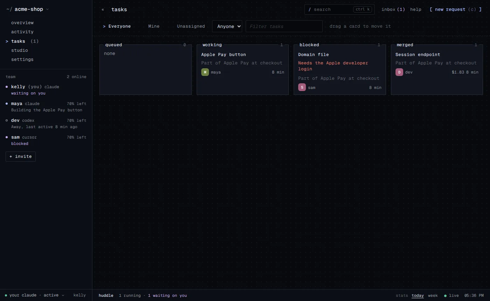
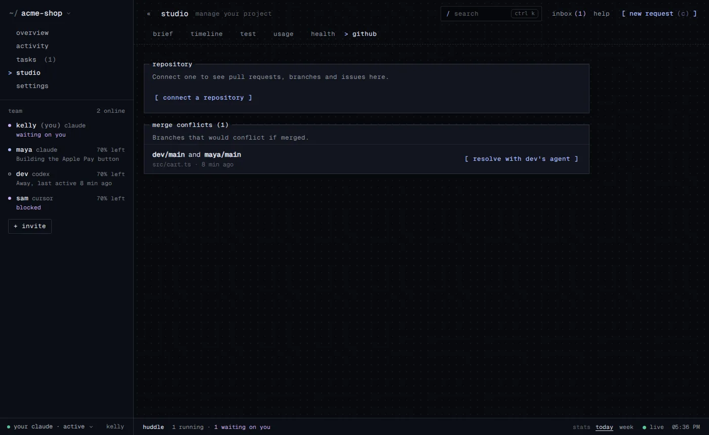
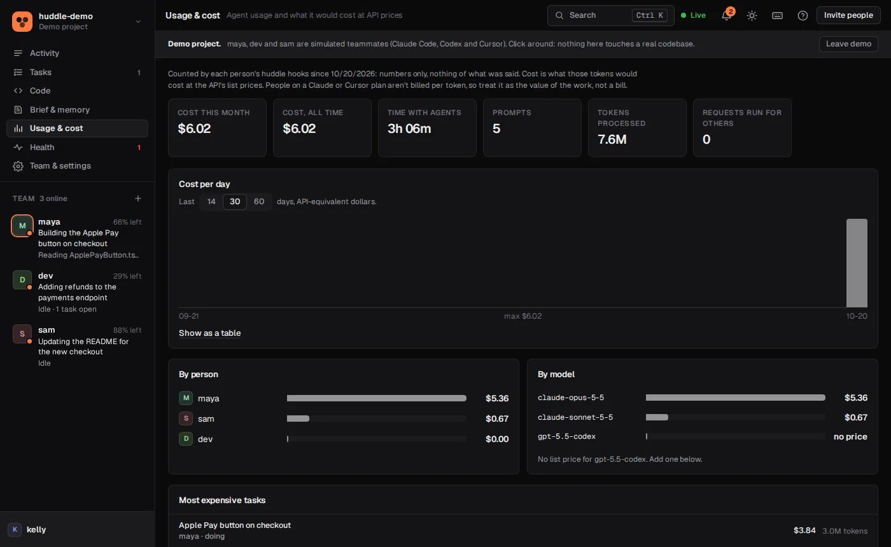
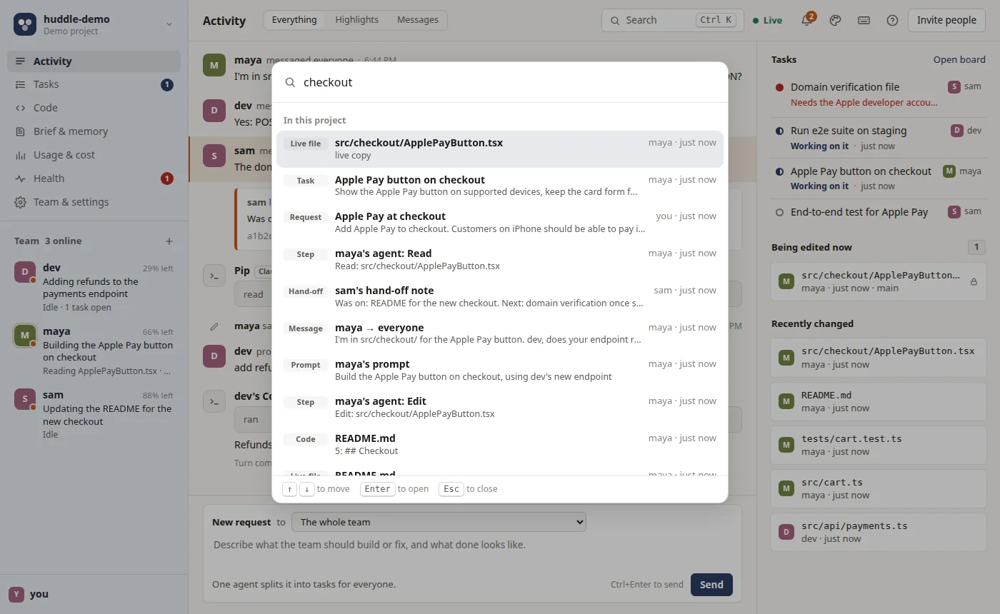
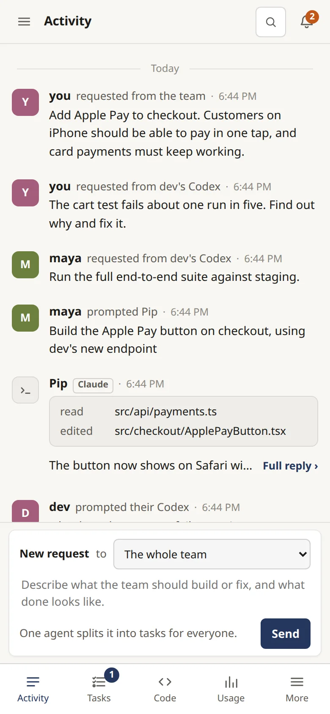
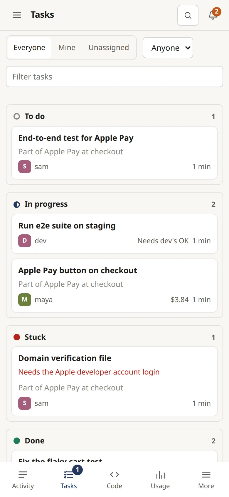
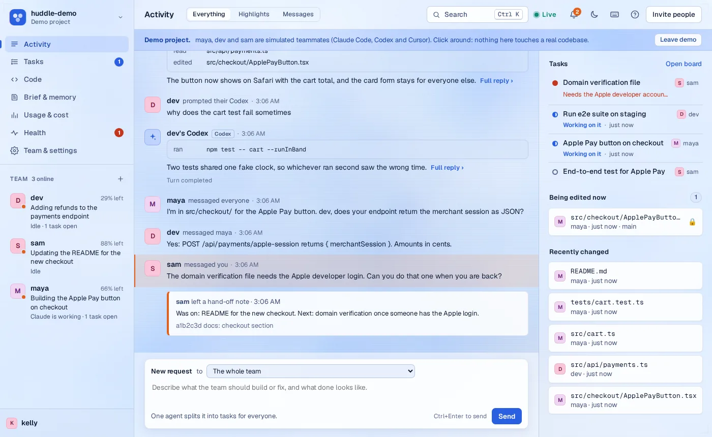

# huddle

**A whole team's AI coding agents, working on one codebase at the same time.**

Everyone on your team keeps using their own agent (**Claude Code**, **OpenAI Codex** or **Cursor**, on their own subscription and computer). huddle connects them, so they see what the others are doing, never overwrite each other, hand work back and forth, and keep going while their people are away.

```sh
curl -fsSL https://huddle.sage-hill.workers.dev/install.sh | sh                 # start a project, get an invite link
curl -fsSL https://huddle.sage-hill.workers.dev/install.sh | sh -s -- <invite>  # everyone else, in their copy of the repo
```

On Windows use `irm https://huddle.sage-hill.workers.dev/install.ps1 | iex`. The invite link (`…/j/<code>`) shows each person the exact command for their computer, and `huddle doctor` checks a folder's setup. The same thing works with `npx -y github:flyingf15h/huddle new` and `… join <invite>`.

That's the whole setup. No sign-up needed (accounts are optional), nothing committed to your repo, zero dependencies for the CLI.


<table><tr>
<td></td>
<td></td>
</tr><tr>
<td></td>
<td></td>
</tr></table>

<p align="center">  </p>


### How it differs

- **Agent managers that run many agents for one person** (worktree-based tools) don't coordinate between people: your agents and your teammate's still collide. huddle locks files across everyone's machines and streams live edits, before anything is committed.
- **One vendor's cloud agents and team features** work for that vendor's agent. huddle puts Claude Code, Codex and Cursor on the same board, with the same locks, rules, reviews and costs, and the agents run on each person's own computer and subscription.
- **It stays out of your repo.** Nothing is committed, and your conversation stays private by default.

### Work together without collisions

- **File and folder locks.** The moment an agent starts editing a file, it's locked for that agent. Everyone else's copy goes read-only, and their agent is told who has it and what to do instead.
- **Live edits.** Every change streams to the other machines as it happens. Watch a teammate's file change in real time on disk or in the dashboard, before anything is committed.
- **Agents talk to each other.** "Ask Kelly's agent if anyone is touching the schema" just works. Messages land in the other agent's context, and it answers before it stops.
- **Shared team knowledge.** A project brief, team memory and skills that every agent reads when it starts, so nobody rediscovers the same gotcha twice.

### Hand off work, even while you're away

- **One request, split across the team.** Describe a feature once; one agent plans it and hands the parts to whoever has the most usage left in their 5-hour window.
- **Background agents.** Requests sent to your agent run on their own, each in a separate git worktree, so several run at once without touching what you're doing.
- **Checked before it lands.** A second agent reviews every change and the tests run before anything merges. Failing work waits on its own branch.
- **Pull requests, if you prefer.** Switch delivery to PR and finished work shows up on GitHub with its review and test results in the description.

### Stay in control

- **Personal access with roles.** Owner, member or viewer. Take anyone's access back in one click, including sessions they have open.
- **Rules every agent follows.** Commands that are always fine (`npm test`), commands no agent may ever run (`git push`, deploys), and files that never leave anyone's machine.
- **Secrets stay secret.** API keys, tokens and passwords are stripped from everything shared, before it leaves your computer.
- **Audit log.** Who changed access, settings and rules, every approval, and every command a background agent ran.

### Know it's working

- **Live dashboard.** What every person and their agent is doing right now, tasks and progress, the code on everyone's branches, and a box to send work to the team.
- **Health page.** Crashes, automatic retries (up to three per run), who needs an update and whose background runner is on.
- **Alerts in Slack or Discord** when work is stuck, needs your approval, or finishes. Plus a public `/status` page.
- **Notifications for you.** Messages, mentions, requests, approvals, stuck work, merge conflicts and failing checks, in the app, on your desktop and by email, each switchable. Emails close together arrive as one.
- **A daily digest.** One short summary a day (what finished, what's stuck, what the agents cost), to the owners or to everyone, by email, as a pop-up in the dashboard, or both. Owners choose the time and time zone; a quiet day sends nothing.
- **Search everything.** Tasks, messages, what agents were asked and replied, memory, hand-off notes and the code teammates shared. Agents can search too (`huddle_search`).
- **What it costs.** Tokens priced per model (list prices built in, add your own), per person, day and task, with a monthly budget that warns owners.
- **Merge conflicts, early.** Each person's huddle checks whether teammates' branches would conflict with theirs, names the files, and one click hands the merge to an agent. Background work settles conflicts with its owner's branch before it lands.
- **Your GitHub repository.** Branches with their checks, pull requests, commits and issues in the dashboard, instant updates through a webhook, issues sent to the team as requests, and pull requests opened from huddle.

Each person needs Claude Code, Codex or Cursor, Node 18+ (22+ recommended) and git. Linux is what it's developed on; macOS and Windows are covered by a CI matrix (see `.github/workflows/test.yml`), and `huddle doctor` flags problems on any of them.

## Quick start

**1. One person creates a project** on the free public server, from inside their copy of the project:

```sh
cd ~/code/myapp
npx -y github:flyingf15h/huddle new
```

That sets up your folder and prints an invite like:

```
npx -y github:flyingf15h/huddle join bJvEvfkVhOrA
```

The invite is a 12-character code. Anyone with it can join, so only send it to your team.

**2. Everyone else runs the invite in their copy of the project:**

```sh
cd ~/code/myapp
npx -y github:flyingf15h/huddle join bJvEvfkVhOrA
```

It asks for your name (suggesting your git name), checks that Claude Code and git are installed, and offers to let Claude do routine edits, git, builds and tests without asking each time. The invite works in any form: the short code, the dashboard link, the whole command pasted as is, or an older long invite. On your own server, add `--server URL` (or use the dashboard link, which includes it). That's it. Start Claude Code in that folder and it's in the huddle. Each person uses their own Claude login, from anywhere.

Everyone needs the same starting code (clone the same repo/branch). huddle keeps files in step while you work, but it doesn't replace git.

The public server is `https://huddle.sage-hill.workers.dev`, running on Cloudflare's free tier. Every project gets its own token, so an invite only opens that one project. Projects untouched for 30 days are deleted. Shared files are capped at 1 MB each and 10 MB per project. If you'd rather not use it, see [Hosting your own server](#hosting-your-own-server).

## Using it with Claude

Everyone uses their own Claude Code with their own subscription (Pro, Max, Team, API key, anything) on their own computer. huddle never touches your Claude account. It plugs into Claude Code through hooks and an MCP server, and those talk to the huddle server over HTTPS. So it doesn't matter whose subscription it is or where they are.

After `join`, open Claude Code in that folder (restart it if it was already open) and prompt it normally. You don't have to mention huddle. At the start of every session Claude is told who else is online and what they're doing, which files are locked, and the team's PROJECT.md, memory and skills. Some prompts that use it directly:

- "What is everyone working on right now?"
- "Tell sam I'm taking over the auth module" / "Ask the others if anyone is touching the database schema"
- "Wait until the parser file is free, then add error recovery"
- "Remember for the team that the tests need Docker running"
- "Add our deploy steps to the shared PROJECT.md"
- "Turn how we cut a release into a shared skill"

Check `/mcp` in Claude Code if the tools don't show up: `huddle` should be listed as connected.

## Using it with Codex

Join with `--agent codex` (huddle picks Codex on its own when it's the only one installed, and asks when both are):

```sh
npx -y github:flyingf15h/huddle join bJvEvfkVhOrA --agent codex
```

That puts huddle's MCP server in `.codex/config.toml` and its hooks in `.codex/hooks.json` for that folder (both kept out of git), and the team's shared skills in `.agents/skills/`. The first time you run `codex` there, say yes when it asks to trust the folder, then run `/hooks` once and trust huddle's hooks. After that a Codex session gets everything a Claude session does: locks (an `apply_patch` that touches a file someone else holds is refused), live edits, messages, the board, the brief and memory, its activity in the feed, and its 5-hour and weekly limits for handing out work.

Background work for a Codex user runs as `codex exec` in its own git worktree, in Codex's workspace-write sandbox (no network). Commands the person approves, and the project's always-allowed and never-allowed commands, become a Codex rules file for that run. Teammates see "kelly's Codex" wherever they'd see "kelly's Claude".

## Using it with Cursor

Join with `--agent cursor` (huddle picks it when it's the only one it finds, and asks when there are several):

```sh
npx -y github:flyingf15h/huddle join bJvEvfkVhOrA --agent cursor
```

That writes huddle's MCP server to `.cursor/mcp.json`, its hooks to `.cursor/hooks.json` and a short rule to `.cursor/rules/huddle.mdc` (kept out of git, beside any of your own). In Cursor, enable the `huddle` MCP server and trust the project hooks the first time. Then a Cursor agent gets locks (a `Write` or `Delete` on a file someone else holds is refused), live edits, messages (they arrive with the next tool result, since Cursor can't add context when a prompt is sent), the board, the brief and memory, and its activity in the feed.

Background requests for a Cursor user run Cursor's command line, `agent -p --force`, in their own git worktree, with the project's always-allowed and never-allowed commands written as `.cursor/cli.json` permissions. That needs the CLI (`curl https://cursor.com/install -fsS | bash`) and `CURSOR_API_KEY` or `agent login`. Cursor doesn't report token counts to huddle, so its cost and usage figures stay empty.

## Working together in real time

GitHub isn't involved in any of this. Everything goes through the huddle server as it happens.

- **Edits are live.** When two people are on the same branch, every edit one Claude makes lands in the other person's copy of the file within a second or two. While a Claude is editing a file it's locked: the file goes read-only for everyone else, and their Claude is told who has it instead of overwriting their work.
- **Whole folders can be locked.** A Claude (or you, with `huddle lock src/pages/`) can lock a folder before a bigger change: nobody else can edit anything inside it until it's released or that session ends, and no two locks may overlap, so nobody can lock a file inside someone's folder or a folder around someone's file.
- **Everyone knows what everyone is on.** When you give your Claude new work, the team sees a short title from your prompt straight away, and then the one-sentence summary your Claude sets with `huddle_set_status`. Each Claude is only told when another Claude's work changes, so this costs a few tokens, not a running report.
- **Kept light on usage.** huddle doesn't start extra Claude runs for summaries (set `"summarize": true` in `.huddle/config.json` if you want a separate Haiku summary per prompt). Background answers to messages and planning team requests run on Sonnet (`"answerModel"` / `"planModel"` to change), at most 8 automatic answers an hour. Send work to a teammate's Claude from the dashboard instead of asking your own Claude to pass it on, and none of it goes through your session.
- **Hand-off notes.** When a session ends, it leaves a short note on where it left off and what's next (Claude writes it with `huddle_handoff`, or huddle writes one from its status, edited files and commits). The rest of the team sees it, and so does your next session.
- **Commits are shared automatically.** Whenever a Claude finishes a turn, any new commits are sent to the rest of the team through huddle. People on other branches get them when they merge (see [branches and merging](#different-versions-branches-and-merging)).
- **The Claudes message each other.** A Claude can message the whole team or one person's Claude, and the message shows up in the other Claude's context at its next step. A Claude that gets a direct message has to answer it before it stops. They also coordinate through the shared task list.
- **Requests start right away.** Something sent to a person's Claude with *New request* starts immediately unless their Claude is set to Off (see [Autopilot](#autopilot-what-your-claude-does-with-work-from-the-team)). A Claude that's mid-turn reads messages at its next step; an idle one answers in the background.

## Talking to all the Claudes at once

Write it in the **New request** box at the bottom of the dashboard (or run `huddle ask "add a history feature with tests"`) and pick who it's for:

- **Full team:** the first free Claude claims it, looks at the code, splits it into tasks with an owner each (split by file so nobody collides, with dependencies where needed), and tells the team. Every Claude is told which tasks are theirs, works on them, commits, and marks them done. Progress shows under **Tasks** on the right side of the dashboard.
- **One person's Claude:** pick them under **to**, or hover them in the team list and press **Ask**. Only their Claude gets it, as a task of its own, and runs it in the background on their computer if their mode allows; your own Claude isn't involved. Its reply comes back to you in the activity feed and your notifications. From the terminal: `huddle ask "..." --to alex`.
- **One open session:** when someone has several Claude Code sessions open, each is listed under their name in **to**, with its branch, when it started and what it's doing. Picking one sends that session a message: it reads it at its next step if it's working, or when its person next uses it if it's idle, and it replies to you in the feed.

### Autopilot: what your Claude does with work from the team

Each person chooses, and can change it any time. It decides what starts in the background on your computer while your own Claude session isn't doing it:

| Setting | Requests and messages sent to your Claude | Team-wide requests and unassigned tasks |
|---|---|---|
| **Active** (default) | Start on their own | Your Claude plans team requests and takes open tasks |
| **Requests only** | Start on their own | Left to the others |
| **Off** | Wait until you open Claude in the project | Left to the others |

What that means in practice:

- **It doesn't matter who sent it.** A request from a person on the dashboard and one from another person's Claude (`huddle_ask_team` with a name) are treated the same, and so are messages.
- **Requests never need approval.** The only approval step is for shell commands (see [Commands that need your OK](#commands-that-need-your-ok)), and that applies in every mode.
- **Messages:** when another Claude messages yours and your session is idle, a short background Claude answers it. Automatic answers never start another run, so two Claudes can't keep each other going. If your session is busy, your Claude reads the message at its next step instead. With Off, messages wait for you.
- **Each request runs as its own Claude** (a new conversation in its own git worktree, up to 3 at once), so the conversation you're having isn't interrupted. When one finishes, its commits merge into your branch if they merge cleanly; otherwise they wait on `huddle-request-<id>` and the sender is told.
- **With Off,** your Claude is reminded about waiting requests when you next start it, and you decide what to do with them.

Background work needs Claude Code open in the project folder, or `huddle autopilot` running in a terminal there.

Change it from the menu at the bottom of the dashboard's sidebar, with `/autopilot on`, `/autopilot requests` or `/autopilot off` inside Claude Code (or just ask Claude), or with `huddle autopilot on|requests|off` in a terminal. The team list shows each person's status with a dot: orange for Active, green for online, grey for away.

### Checks before background work lands

Before work from a background Claude merges into your branch, two things check it, both on Sonnet to save usage. First, a Sonnet Claude reviews the diff for real bugs (not style), and gets one pass to fix what it finds. Then the project's tests run in that work's own worktree, and Sonnet gets one try to fix a failure. Work that still fails the tests stays on its `huddle-request-<id>` branch and the task is marked blocked. Tests that were already failing before the change don't hold it back. huddle guesses the test command (`npm test`, `pytest`, `cargo test`, `go test`, `make test`), or set it with `huddle tests "npm run check"`. `huddle tests --review off` turns the review off. The dashboard shows "Tests pass", "Tests failed" and "Reviewed" on each task.

### Pull requests instead of merging

`huddle delivery pr` (or Team & settings → Rules) makes finished background work arrive as a GitHub pull request instead of being merged into its person's branch: the worktree's commits are pushed as `huddle/<task>-<title>` and opened against that person's branch (or the default one) with the request, who asked, and the review and test results in the description. The task links to it and shows when it's merged. It needs the `gh` CLI, signed in, on each computer that runs background work.

### Commands that need your OK

A background Claude runs in Claude Code's auto mode, like your own sessions: safe commands go through and risky ones (deploys, publishing, deleting things outside the project) are refused, because nobody is there to approve them. When it needs one of those, it does what it can and asks. The command shows under **Awaiting your approval** in the dashboard, and you get a notification. Commands for the same request are grouped, with one **Approve all** / **Decline all**. Decide there, or with `huddle approve ID` (or `huddle approve --all`) in a terminal, or just tell your Claude. The task then runs again once, with those exact commands allowed. Inside its own worktree a background Claude can already fetch, merge, cherry-pick, rebase and restore without asking, since nothing reaches your branch until huddle has reviewed, tested and merged it. Only you can approve commands for your Claude. Approving from a browser needs the page to be opened with `huddle open` on your computer, which hands it a key nobody else has, so don't share that link.

### When someone runs out of usage or leaves

Tasks waiting for someone whose 5-hour window is over 90% used, or who has been offline for 10 minutes, move to an active teammate with room. So do tasks whose Claude hit its usage limit partway through, and tasks still in progress after their owner has been gone 20 minutes. A note on the task says why. Requests sent to one specific person stay with them.

### Locks for a whole task

A file is locked the moment a Claude edits it. Plans also give each task the files or folders it works in, and those are locked from the moment the task starts, so another Claude can't begin in the same place. A task whose area is taken waits and tries again a few minutes later.

### Catching up

Coming back after half an hour or more, the dashboard shows one dismissible line, like "Since 3 h ago: 4 tasks done · 2 messages · 1 waiting for your OK". The first Claude session you start gets the same summary in your terminal.

### Splitting big prompts across the team

When you give your Claude a prompt with several separate pieces of work, huddle suggests splitting it. Your Claude calls `huddle_distribute` with each part and how big it is (light, medium or heavy). huddle gives the heavier parts to whoever has the most of their 5-hour Claude window left, the other Claudes start on theirs right away, and your Claude does the parts it kept. Team-wide requests from the dashboard are split the same way. Each person's Claude Code status line reports how much of their window is used, and their card on the dashboard shows what's left.

Autopilot runs Claude on *your* computer with *your* Claude subscription, so your laptop has to be on. It needs either a Claude Code session open in the folder, or `huddle autopilot` running in a terminal there (for when you don't want Claude open). Each request, task or answer is its own Claude Code session, the same as if you had started a new conversation yourself: it starts for that one job and ends when the job is done. It runs in auto mode (accounts without auto mode get `acceptEdits`, which allows edits, git and the commands you've allowed), with your settings, your `CLAUDE.md` and `CLAUDE.local.md`, your `.claude/settings.local.json` and the MCP servers you added for the project folder. Pick another mode with `"autopilotPermissionMode": "acceptEdits"` in `.huddle/config.json`, or `huddle autopilot --permission-mode acceptEdits`. Allow more with `--allow`, for example `huddle autopilot --allow "Bash(npm test:*)"`, or set `"autopilotAllow": ["Bash(npm test:*)"]` in `.huddle/config.json` so it also applies in the background.

You hear about messages and requests sent to your Claude right away: while a Claude Code session is open in the folder, huddle shows a desktop notification for each message to you (or to everyone) and each request for your Claude, so you don't have to wait for your next prompt. Your Claude also leads its next turn with them. Set `"notify": false` in `.huddle/config.json` to turn the pop-ups off.

Board tasks close themselves: a commit whose message says `closes <task id>` (or `[<task id>]`) marks that task done, and when your Claude starts on something new it's reminded of tasks it still has in progress.

## Reviewing, scheduling and always-on teammates

- **Diff review.** Each background task's changes can be read in the dashboard (Tasks, then Review changes): comment on lines, approve, ask for changes (the agent runs the task again with your comments) or merge work left on a branch.
- **Second opinion.** If the team uses more than one kind of agent (say Claude and Codex), the review of a change comes from a different vendor than the one that wrote it, when that command line is on the computer doing the work. Switch it off under Rules.
- **Conflict-aware planning.** Tasks that touch the same files wait for each other instead of colliding, and the task says why it is waiting.
- **Schedules and GitHub.** Start a request on a timer (Settings, Integrations), or label a GitHub issue or comment `/huddle` to turn it into one.
- **Cost alerts.** Owners hear about a spike in a day's cost, a month on course to pass the budget, or one expensive task. Usage shows the forecast.
- **Slack.** `/huddle status`, `/huddle @ana fix the cart test`, and Approve or Decline buttons, set up in Settings, Integrations.
- **Workers.** `huddle worker <invite> --repo URL` keeps an always-on teammate on a server; see docs/worker.md.

## Accounts, roles and access

A new project has one shared invite: whoever has it is in. For a team you'd rather manage, the owner sets up accounts:

```sh
huddle members setup                  # you become the owner, with your own token
huddle members invite                 # a personal invite for one person (--role viewer, --uses N, --days N)
huddle members                        # who's on the project, their roles, open invites
huddle members role kelly viewer      # owner, member or viewer
huddle members remove kelly           # their access stops at once, open sessions included
huddle members revoke <invite id>     # take back an invite nobody has used
huddle members shared off             # once everyone has their own access: the shared invite stops working
```

Or do all of it from **Team & settings** on the dashboard. Each personal invite works once (unless made for more people) and expires after a week. A personal token always speaks as its own person, so nobody can post as someone else. **Viewers** see everything and change nothing. Only **owners** change project settings, rules, notifications and roles.

**Accounts for people.** Sign in on the home screen with an **email code** (or the link in the email) or **GitHub**. Your projects and their keys follow you to any browser, and linking your account to a project (Team & settings) opens it without an invite link and sends your notifications to your email. Download or delete your account from Team & settings → Data & privacy.

**Sign in with GitHub** (when the server has it set up, see Hosting): link your GitHub account under Team & settings, and from then on you can open the project from any browser by signing in, without an invite link.

## Rules for every agent

Owners set these under **Team & settings → Rules** (or `huddle policy`):

- **Always allowed in background runs**, e.g. `npm test`, `npm run build`: background agents run them without asking anyone.
- **Never allowed**, e.g. `git push`, `npx wrangler deploy`: refused for every agent, in background runs and in each teammate's own sessions, and they can't be approved.
- **Private files** (by default `.env*`, `*.pem`, `*.key`, `secrets/` and friends): never locked, live-shared or shown in the Code view.
- **The most a session may share**: everything, steps only, or nothing. Each person can share less, never more.

API keys, tokens and passwords are taken out of the feed, statuses and hand-off notes before they leave anyone's computer, and again on the server. The **audit log** (Team & settings → Audit log, or `huddle audit`) records who changed access, settings and rules, every approval, and every command background agents ran.

## Notifications

**Yours.** The bell lists what's for you: messages and @mentions, requests sent to your agent, commands waiting for your OK, your work getting stuck, requests of yours that finished, merge conflicts with your branch, failing checks on your pull requests, and budget alerts (owners). Under Team & settings → Notifications choose, per kind, whether it also goes to your **email** and your **desktop** (`huddle notes email|desktop KIND on|off`). `huddle notes` lists them in the terminal.

**The team's.** 
Under **Team & settings → Notifications** (or `huddle notify add <webhook URL>`), the owner adds a Slack incoming webhook, a Discord webhook or any URL that takes JSON, and picks when it fires: a command needs approval, a task is stuck, a request is done, something failed, someone joined. The URL stays on the server; the team only sees that a channel exists.

## Health and status

The **Health** page shows whether everyone's huddle is working: who's online with Claude Code or Codex, whether their background runner is on, who needs `huddle update`, crashes and failures reported from people's computers (with details), and every background run attempt. A run that crashes is tried again up to three times, and each attempt shows on its task. `huddle problems` lists the same from the terminal. Every server also has a public `/status` page.

## Different versions, branches and merging

huddle carries git history between people itself (as git bundles through the server), so nobody needs access to anyone else's GitHub remote.

- **Joining with a different version:** `join` compares your copy with the team's. If they differ, you choose to merge theirs into yours (Claude can resolve conflicts), keep yours on your own branch and merge later, switch to theirs (yours is kept on a backup branch), or skip. Run `huddle sync` to do it again later. A folder that isn't a git repo gets git set up first.
- **Same branch or separate branches:** people on the same branch share a live working copy, with locks. On different branches (`huddle branch own`) nobody blocks anybody, but you still see each other's activity, chat and board, and get a heads-up when two people edit the same file on different branches. `huddle branch join alex` puts you back on someone's branch.
- **Merging:** commits are shared automatically at the end of each Claude turn. Everyone else's branches show up as `huddle/<person>/<branch>`, so `huddle merge alex` (or asking Claude "merge alex's branch") merges them. On conflicts, Claude gets the list of files to resolve.
- `.huddle/` and `.claude/settings.local.json` are always kept out of git. History that contains them is refused, so your invite token can't leak through a merge.

## Is this session in the huddle?

Two places tell you:

- **The status line** at the bottom of Claude Code shows `● huddle · physical-studio · Kelly online · takes requests` in any folder that's in a huddle. No huddle line means that session isn't connected. (huddle only adds it if you don't already have your own status line. Otherwise run `/mcp` and look for `huddle`.)
- **When the session starts**, a one-line notice says which project it joined, who else is online, and what your Claude does with requests.

Only sessions started in a joined folder (or a folder linked with `huddle link`) are in the huddle. A session that was already running when you joined isn't; restart it.

## The dashboard

Open it with `huddle open` in a joined folder, or with the dashboard link `join` printed. It updates live, so you can leave it open in a tab while you work. It has a light and a dark theme (following your system until you pick one with the button in the header), both drawn over a still image of water in the style of the Submerge wallpaper.

- **Sidebar:** the project switcher at the top, then the four pages, then the team list: what each person's Claude is working on, what's happening right now (including background Claudes), how much Claude usage they have left, and a dot for their status. Click someone to see only their activity. Right-click yourself, or click your name at the bottom, to change your name or your Claude's name; everything you did moves to the new name, and your computer's huddle config picks it up. Your Claude's mode is at the bottom.
- **Activity:** everything that happens, newest at the bottom. Each row says who did what ("tszfei requested from the team", "kelly messaged you"), then the content: prompts, the steps Claude took (long runs collapse), a one-line summary of its reply (hover for all of it), plans, and messages. Filter by Everything, Claude's work or Messages.
- **Code:** Files, GitHub (branches with checks, pull requests, commits, issues) and Conflicts tabs. Pick anyone's shared branch and browse its files. A file someone is editing right now is marked with a lock and has a **Show live version** button, so you can watch it change before anything is committed.
- **Brief & memory:** the project brief, team memory and shared skills that every Claude reads when it starts. You can read and edit all of it there.
- **Tasks:** the board, with columns you can drag cards between, filters, a details panel (edit, comment, rerun, delete, runs, checks, cost).
- **Usage & cost:** how much each person used their agent, and what it would cost at API prices, with a daily chart, per person and model, the priciest tasks and an optional monthly budget.
- **Health:** crashes, retries, who needs an update, and whose background runner is on (see Health and status).
- **Team & settings:** people and roles, invites, rules, the GitHub integration, notifications, data and privacy controls (export, how long things are kept, erase, delete) and the audit log.
- **Search and keyboard:** press `/` or `Ctrl K` to search the project; `g` then `a t c b u h s` jumps between pages, `j`/`k` move through lists, `c` starts a request, `?` lists every shortcut. On a phone the pages are a tab bar at the bottom.
- **Right side:** task progress for every request, which files are being edited right now and by whom, and recently changed files.
- **New request:** the box at the bottom, for giving the Claudes something to build (see above).
- **The bell** lists messages to you, requests for your Claude and commands waiting for your approval, with **Mark all as read**. Set it to **Do not disturb** to keep collecting them without pop-ups or desktop alerts, and turn desktop alerts on from there.
- **Invite people** shows the command to send a teammate. The **?** button explains huddle, including the modes, and runs a short tour.

If you're in several projects, each one has its own dashboard address (`…/#p=project-name`), so separate tabs and bookmarks stay on their own project. The plain address opens the project you used last, and the switcher at the top of the sidebar lists every project you've opened in that browser. Press Escape or **Back** on the invite screen to return to the project you came from.

## What's shared, and what isn't

- Only Claude Code sessions started **inside the joined folder** are connected. Claude anywhere else on your computer never sees huddle and nothing from it is shared.
- Inside the folder, the team's timeline shows which tools your agent ran (commands, files). **Your conversation stays on your computer** unless you choose `huddle sharing full`, which also shares your prompts and your agent's replies. To keep one turn to yourself even then, start the prompt with **`private:`**, e.g. `private: draft a message to my manager`. That whole turn stays out of the feed, and Claude is told not to repeat it to the team. File edits still sync, since they're project work.
- `huddle sharing off` shares neither the conversation nor the tool steps. An owner can cap what anyone shares with `huddle policy sharing`.
- Secrets never leave your computer: `.env` files, keys, cloud credentials and similar files are never uploaded (see `huddle policy private`), and API keys, tokens and passwords are stripped from everything shared. `huddle doctor` checks this setup.
- Keep your huddle projects together in one parent folder? Run `huddle link PROJECT_FOLDER` in the parent, and Claude started in the parent joins that project's huddle too. Only files inside the project folder are shared; anything else in the parent stays yours. `huddle unlink` undoes it.
- The Claudes' huddle tools only reach the project the folder is joined to. Each project has its own token, and nothing crosses between projects.

## Shared team knowledge

None of this lives in git, so you can use huddle on a repo without committing anything to it.

- **PROJECT.md**: the project brief (goals, conventions, architecture, who owns what). Every agent gets it at session start, like a CLAUDE.md the whole team shares. Edit it with `huddle project --edit`, load an existing file with `huddle project --set CLAUDE.md`, edit it in the dashboard, or have an agent do it with `huddle_project`.
- **Memory**: short notes like "tests need FOO=1, otherwise the db fixture hangs". Agents save them with `huddle_remember` when they learn something the others would otherwise rediscover, and everyone else sees new ones right away.
- **Skills**: shared `SKILL.md` procedures, installed into everyone's `.claude/skills/` (and kept out of git through `.git/info/exclude`). Share one with `huddle skill add path/to/skill`, or have an agent use `huddle_save_skill`.

A copy of everything is kept in `.huddle/shared/` in each folder.

## What the agents get

Hooks (in `.claude/settings.local.json`) enforce the rules on their own, so agents don't have to remember anything:

| When | What happens |
| --- | --- |
| Session starts | Agent is told who else is online, what they're doing and what's locked |
| Before Edit / Write | File gets locked for this agent. If someone else has it, the edit is refused and the agent is told who, plus its options. If this copy is out of date, it's refreshed first and the agent re-reads it |
| After each edit | New contents go to the server and out to everyone else's disk |
| After any tool / each prompt | New messages from other agents get added to the agent's context |
| Turn ends | Its locks are released, unless it reserved them with `hold` (folder locks stay). Commits that say `closes <task>` close it. If someone sent it a direct message, it has to answer first |
| Session ends | Everything it held is released, and a hand-off note is left if Claude didn't write one |

Each prompt is one request to the server: it shares the prompt and status, reads mail, and gets back only what changed since that Claude last looked (other Claudes' work, the board, shared knowledge, new hand-off notes).

MCP tools (registered for that folder only):

| Tool | Use |
| --- | --- |
| `huddle_status` | Who's online, what they're doing, locks, recent edits |
| `huddle_set_status` | "Working on the auth middleware" |
| `huddle_send` | Message everyone, or one agent by name |
| `huddle_inbox` | Read messages; can block waiting for a reply |
| `huddle_lock` / `huddle_unlock` | Reserve files or whole folders up front, optionally across turns |
| `huddle_handoff` | Leave a note on where you left off and what's next |
| `huddle_wait` | Block until a locked file is free, then take it |
| `huddle_view` | See another agent's file mid-edit |
| `huddle_project` | Read or update the shared PROJECT.md |
| `huddle_remember` / `huddle_recall` / `huddle_forget` | Shared team memory |
| `huddle_save_skill` / `huddle_delete_skill` | Shared skills |
| `huddle_activity` | What the other Claudes are doing |
| `huddle_ask_team` / `huddle_board` | Give the team a goal, see goals and tasks |
| `huddle_claim_goal` / `huddle_plan` | Plan a goal: split it into tasks with owners |
| `huddle_claim_task` / `huddle_update_task` | Take a task, mark it doing/done/blocked |
| `huddle_branches` / `huddle_publish` / `huddle_merge` | Everyone's branches, share yours, merge theirs |

## Commands

```
huddle new [NAME] [--server URL]       create a project (public server by default)
huddle server [--port 7777] [--tunnel] [--project NAME] [--data DIR] [--open]
huddle join <invite> [--name NAME] [--agent claude|codex|cursor]  set up the current folder
huddle doctor                          check this folder's setup: hooks, tools, privacy
huddle leave                           undo join in this folder
huddle update [--from DIR] [--ref REF] newest huddle from GitHub (or a local checkout), hooks refreshed in every joined folder
huddle permissions [--write]           shared .claude/settings.json: no prompts for edits, huddle, git, builds and tests
huddle search WORDS                    search tasks, messages, activity, memory and shared code
huddle notes [read]                    your notifications; huddle notes email|desktop KIND on|off
huddle cost                            API-equivalent cost per person and task
huddle conflicts                       which teammates' branches would conflict with yours
huddle export [--out FILE]             everything the project holds, as JSON (owner)
huddle status                          each person, their Claudes and what they're on, locks, recent edits, hand-offs
huddle tidy                            merge names that differ only in capitals, drop old sessions
huddle handoff ["note"]                leave a hand-off note, or read everyone's
huddle send <text> [--to NAME]         message the agents yourself
huddle inbox [--wait SECONDS]
huddle watch                           live feed in your terminal, keeps files synced while you edit by hand
huddle lock <file|folder/> / huddle unlock [file|folder/]
huddle invite                          print the invite (a personal one once the project has accounts)
huddle open                            open the dashboard
huddle members [setup|invite|role|remove|revoke|shared]   accounts and access
huddle policy [allow|deny|private|sharing]                rules for every agent (owner)
huddle notify [add URL|rm ID|test]     Slack, Discord or webhook notifications (owner)
huddle delivery [pr|merge]             finished background work as pull requests, or merged
huddle audit                           who changed what, and what background agents ran
huddle problems                        crashes and failures from people's computers
```

`join` copies huddle to `~/.huddle/app` and, if `~/.local/bin` is on your PATH, puts a `huddle` command there. That way the hooks still work after npx clears its cache. `huddle update` replaces that copy with the newest version; the session-start line tells you when a teammate runs a newer one.

## Hosting your own server

Quickest, from any machine that stays on while you work:

```sh
npx -y github:flyingf15h/huddle server --tunnel --project myapp
```

`--tunnel` gives it a public https URL through a free Cloudflare quick tunnel (needs [cloudflared](https://developers.cloudflare.com/cloudflare-one/connections/connect-networks/downloads/)). The URL changes on every restart. Without `--tunnel` you get LAN and Tailscale URLs. It prints the invite to send around.

For something permanent:

- **Cloudflare Workers (free):** `cd worker && npm install && npx wrangler deploy`, then `npx wrangler secret put HUDDLE_SECRET` with a long random string. Never change that secret, because every project token is derived from it. Then `huddle new --server https://your-worker.workers.dev`.
- **Email sign-in (optional):** set `RESEND_API_KEY` (and `EMAIL_FROM`) as Worker secrets, or `HUDDLE_RESEND_API_KEY` / `HUDDLE_EMAIL_WEBHOOK` for the Node server, so codes and notification emails can be sent. `HUDDLE_EMAIL_DEV=1` prints codes in the server log for local use.
- **Sign in with GitHub and repository access (optional):** create an OAuth app at github.com/settings/developers with the callback URL `https://your-server/auth/github/callback`. On Cloudflare, `npx wrangler secret put GITHUB_CLIENT_ID` and `GITHUB_CLIENT_SECRET`; on Node, set `HUDDLE_GITHUB_CLIENT_ID` and `HUDDLE_GITHUB_CLIENT_SECRET`.
- **Docker anywhere:** `docker build -t huddle . && docker run -p 7777:7777 -v huddle-data:/data huddle`, with HTTPS in front. Add `-e HUDDLE_OPEN=1` to let anyone create projects on it with `huddle new --server URL`.

## How it works

- The server keeps agents, locks, the latest contents of every file that's been edited, and chat. The same core (`src/core.js`) runs in Node (`src/server.js`, saved to disk) and on Cloudflare (`worker/`, one Durable Object per project). On Cloudflare, clients stream events over hibernating WebSockets, so idle projects cost nothing. A self-hosted Node server falls back to long-polling and SSE.
- Each Claude session runs the huddle MCP server, which also runs the **sync** for that folder. When an agent on another machine locks a file, sync makes the local copy read-only (`chmod a-w`). Their edits are written in as they happen, and write access comes back when they release it. If a shell command changes a locked file anyway, sync puts the holder's version back and saves yours in `.huddle/conflicts/`. Only one sync runs per folder.
- Locks belong to a single Claude session. If a session crashes, its locks expire after 5 minutes without a heartbeat.
- The invite code is just the server URL, token and project name in base64. Anyone who has it can join, so only send it to the people you're working with. `.huddle/` (which holds the token) is added to `.git/info/exclude`, so it won't get committed.

## Your data

Everything a project holds can be downloaded (`huddle export`, or Team & settings → Data & privacy), kept for a set number of days (activity, messages, audit log, finished tasks), erased per person, or deleted along with the project. Secrets are stripped before anything leaves a computer, and tokens and webhook addresses never appear in an export. See `/privacy` and `/terms` on the server for the plain-language policies.

## Limits

- Edits made with Claude's Edit/Write tools are tracked. Files created or deleted through shell commands aren't shared automatically, so commit and pull those through git as usual.
- Text files up to 2 MB.
- No merging: one agent per file at a time. That's the point, but split big files if agents keep queueing on them.

## Tests

```sh
npm test
```

Starts real servers and fake checkouts for Claude Code, Codex and Cursor sessions, and drives the hooks and MCP servers the same way Claude Code does. `HUDDLE_TEST_URL=https://... npm test` runs the same checks against a deployed open server.
