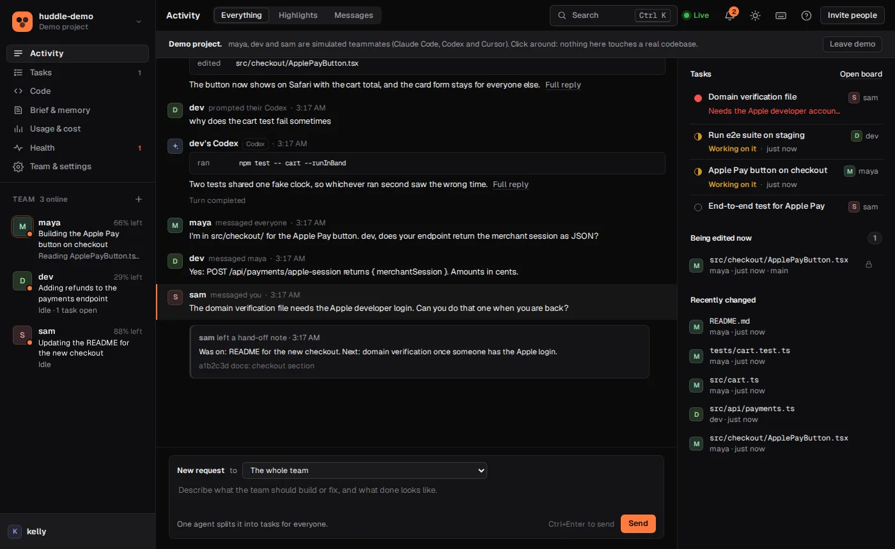

# huddle

**Your whole team's AI coding agents, working on one codebase at the same time.**

You use Claude Code, a teammate uses Codex, someone else is on Cursor. Normally those three agents edit the same files on three laptops and you find out at merge time. huddle connects them. A file one agent is editing is locked for the others, edits show up on everyone's machine as they happen, and the agents talk to each other to split the work.

It's made for small teams where everyone brings their own subscription: hackathon teams, class projects, a few friends shipping something.

```sh
curl -fsSL https://huddle.sage-hill.workers.dev/install.sh | sh                 # start a project, get an invite link
curl -fsSL https://huddle.sage-hill.workers.dev/install.sh | sh -s -- <invite>  # everyone else, in their copy of the repo
```

On Windows: `irm https://huddle.sage-hill.workers.dev/install.ps1 | iex`. No sign-up, nothing committed to your repo.



## What you get

**No collisions**
- While an agent edits a file, everyone else's copy goes read-only and their agent is told who has it. Agents can claim a whole folder before a bigger change.
- Edits land on teammates' machines within a second or two, long before anyone commits.
- Each person's huddle warns when their branch would conflict with a teammate's, names the files, and one click hands the merge to an agent.

**Agents that work as a team**
- They message each other. "Ask dev's agent if anyone is touching the schema" just works, and so does "tell sam I'm taking auth".
- Describe a feature once. huddle plans it and hands each part to whoever has the most usage left in their 5-hour window. If someone runs low or goes offline, their open work moves to someone else.
- A project brief, team notes and skills that every agent reads when it starts, so nobody rediscovers the same gotcha.
- When a session ends it leaves a hand-off note, so the next agent (yours or a teammate's) picks up where it stopped.

**Work that keeps going while you're away**
- Requests sent to your agent run in the background, each in its own git worktree, up to three at once, without touching what you're doing.
- A second agent reviews every change (from a different vendor if your team has one) and the tests run before anything merges. Failing work waits on its own branch.
- Prefer pull requests? Finished work can open one on GitHub, with the review and test results in the description.
- Schedules ("look for flaky tests every Friday"), GitHub issues sent to the team as requests, and an always-on worker for a spare machine.

**Unity and Blender**
- Agents can build scenes, prefabs and models inside the editor, not just code. Scenes and .blend files are locked like any edit, so nobody ends up with two versions of a scene that can't be merged.

**You stay in charge**
- Commands that are always fine, commands no agent may ever run (`git push`, deploys), and files that never leave anyone's machine. Background agents ask before running anything else, and you approve from the dashboard, Slack or the terminal.
- Personal invites with owner, member and viewer roles. Take anyone's access back in one click.
- Secrets are stripped from everything shared, and an audit log records every setting change and every command a background agent ran.

**See all of it**
- A live dashboard: what each person's agent is doing, tasks, the code on everyone's branches, search across everything, and every setting.
- What it costs: tokens priced per model, per person and task, with a monthly budget.
- Alerts when work is stuck, needs approval or finishes, in the app, by email, on your desktop, or in Slack and Discord. Plus a daily digest.

## Quick start

One person, inside the project folder:

```sh
npx -y github:flyingf15h/huddle new
```

It prints an invite. Everyone else runs it in their own copy of the repo:

```sh
npx -y github:flyingf15h/huddle join <invite>
```

Then open your agent in that folder and work like you normally would. You don't have to mention huddle. If something seems off, `huddle doctor` says what to fix.

Start everyone from the same repo and branch. huddle keeps files in step while you work, and git still holds the history.

**Codex or Cursor:** add `--agent codex` or `--agent cursor` to `join` (it's picked for you if it's the only one installed). Trust the folder and huddle's hooks the first time you open it. They get the same locks, messages and board as Claude Code.

## Unity and Blender

Turn them on in the dashboard (Team & settings, then Integrations) or with `huddle apps add unity blender`. Every teammate's agent gets the editor's MCP server at its next session. Each person then sets up their editor once:

- **Unity:** install [uv](https://docs.astral.sh/uv/getting-started/installation/), add `https://github.com/CoplayDev/unity-mcp.git?path=/MCPForUnity#main` in the Package Manager, then open Window > MCP for Unity and click Start Bridge.
- **Blender:** install uv, run `uvx mcp-for-blender install-addon`, turn the add-on on in Preferences, then press N in the viewport and click Start MCP Server.

Now you can ask for "a pause menu in the Menu scene" or "a low-poly crate saved to art/crate.blend". Scenes, prefabs and .blend files are locked when an agent changes them, and an agent is refused a scene a teammate is working on. Background agents don't get editor tools, because the editor has your own folder open.

## Dashboard or terminal

Almost everything lives in the dashboard (`huddle open`): sending requests, approving commands, rules, editors, invites and roles, notifications, Slack, GitHub and exports. The terminal is only for things that happen on your computer: `new`, `join`, `leave`, `doctor`, `update`, `watch` and git syncing. `huddle help` lists every command.

## Privacy

- Teammates see which tools your agent ran, not your prompts or replies. `huddle sharing full` shares the conversation too. Start a prompt with `private:` to keep that turn out of the feed.
- `.env` files, keys and anything marked private never leave your computer, and API keys and passwords are stripped from everything that's shared.
- huddle never touches your agent's account. It plugs in through hooks and an MCP server.

## Hosting

The free public server runs on Cloudflare at `huddle.sage-hill.workers.dev`. Projects untouched for 30 days are deleted. To run your own, `huddle server --tunnel` works from any machine that stays on, or deploy the Worker in `worker/` (see [the guide](docs/guide.md#hosting-your-own-server)).

## Limits

- One agent per file at a time. If agents keep queueing on one big file, split it.
- Edits made with the agent's edit tools stream live. Files changed by shell commands, or by hand in Unity or Blender, travel through git as usual.
- Developed on Linux. macOS and Windows run in CI.

## More

[The full guide](docs/guide.md) covers autopilot, reviews, pull requests, approvals, accounts, branches, notifications and everything else. Run the tests with `npm test`. MIT licensed.
